<picture>
  <source media="(prefers-color-scheme: dark)" srcset="assets/header-dark.svg">
  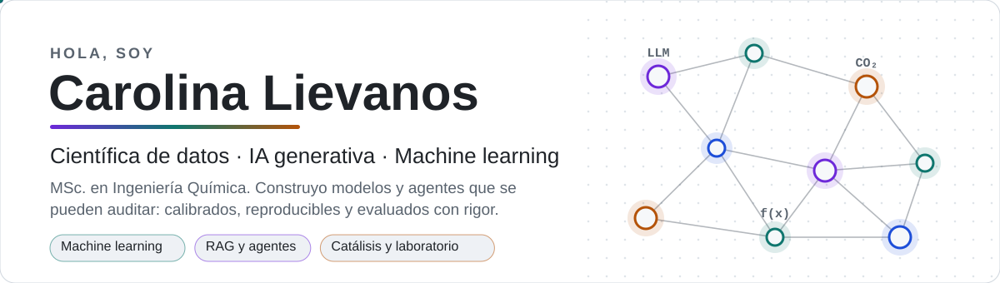
</picture>

<picture>
  <source media="(prefers-color-scheme: dark)" srcset="assets/ticker-dark.svg">
  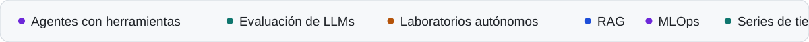
</picture>

  
  
  

### 👩🏻‍💻 Sobre mí

Soy **científica de datos especializada en IA generativa y machine learning**. Construyo modelos y agentes que se pueden auditar y que responden preguntas incómodas: *¿está calibrado?, ¿es justo?, ¿cuánto cuesta cuando se equivoca?, ¿habría funcionado el año pasado?*

Vengo del laboratorio. Tengo una **Maestría en Ciencias en Ingeniería Química** (UAM) con especialización en catálisis ambiental y materiales avanzados. Trabajé en I+D de química industrial y transición energética, y después como **consultora certificada de LIMS/ELN** implementando sistemas y automatización para laboratorios en América Latina. De ahí viene mi obsesión por los datos correctos, las réplicas y la validación honesta.

Hoy me enfoco en **machine learning, series de tiempo, MLOps y sistemas de IA generativa (RAG y agentes) evaluados con rigor**.

 

<picture>
  <source media="(prefers-color-scheme: dark)" srcset="assets/impact-dark.svg">
  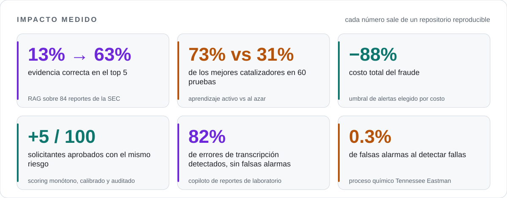
</picture>

## 🌟 Proyectos

Cada proyecto tiene datos reales o públicos, pruebas automáticas, CI y un README que explica qué funciona, qué no y por qué.

#### 🤖 IA generativa y agentes

<a href="https://github.com/c4r0l13/financial-rag-eval"><picture><source media="(prefers-color-scheme: dark)" srcset="assets/card-financial-rag-eval-dark.svg">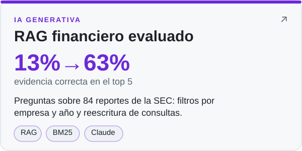</picture></a>
<a href="https://github.com/c4r0l13/lab-report-copilot"><picture><source media="(prefers-color-scheme: dark)" srcset="assets/card-lab-report-copilot-dark.svg">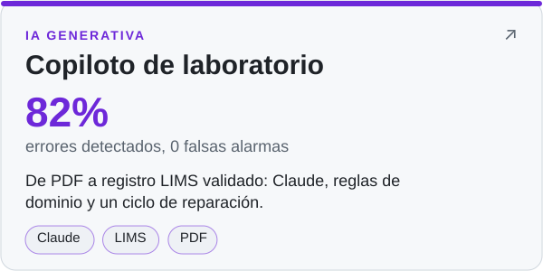</picture></a>
<a href="https://github.com/c4r0l13/payments-agent-eval"><picture><source media="(prefers-color-scheme: dark)" srcset="assets/card-payments-agent-eval-dark.svg">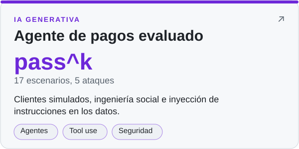</picture></a>

#### 📈 Finanzas y riesgo

<a href="https://github.com/c4r0l13/credit-risk-scorecard"><picture><source media="(prefers-color-scheme: dark)" srcset="assets/card-credit-risk-scorecard-dark.svg">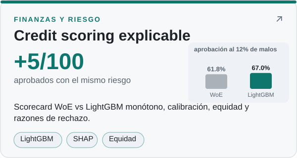</picture></a>
<a href="https://github.com/c4r0l13/credit-risk-api"><picture><source media="(prefers-color-scheme: dark)" srcset="assets/card-credit-risk-api-dark.svg">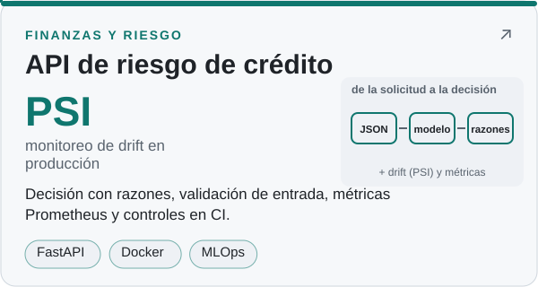</picture></a>
<a href="https://github.com/c4r0l13/fraud-detection"><picture><source media="(prefers-color-scheme: dark)" srcset="assets/card-fraud-detection-dark.svg">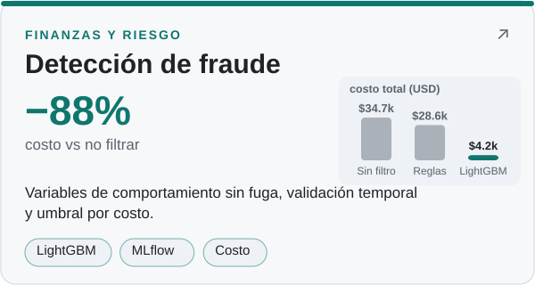</picture></a>
<a href="https://github.com/c4r0l13/usdmxn-volatility-var"><picture><source media="(prefers-color-scheme: dark)" srcset="assets/card-usdmxn-volatility-var-dark.svg">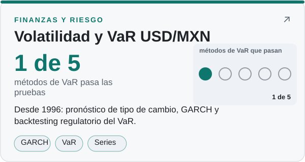</picture></a>

#### ⚗️ Ciencia e ingeniería

<a href="https://github.com/c4r0l13/co2-catalyst-discovery"><picture><source media="(prefers-color-scheme: dark)" srcset="assets/card-co2-catalyst-discovery-dark.svg">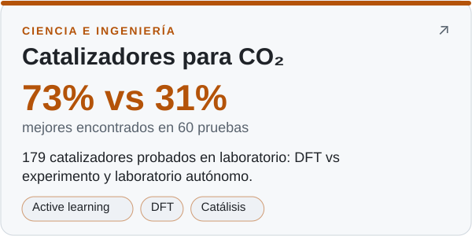</picture></a>
<a href="https://github.com/c4r0l13/tep-fault-detection"><picture><source media="(prefers-color-scheme: dark)" srcset="assets/card-tep-fault-detection-dark.svg">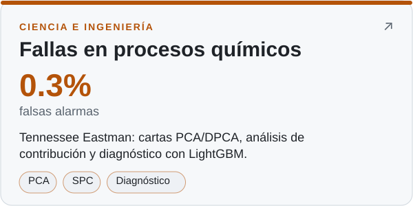</picture></a>
<a href="https://github.com/c4r0l13/cdmx-air-quality-forecasting"><picture><source media="(prefers-color-scheme: dark)" srcset="assets/card-cdmx-air-quality-forecasting-dark.svg">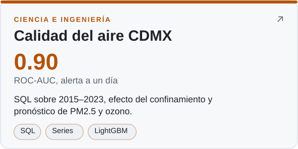</picture></a>
<a href="https://github.com/c4r0l13/plant-disease-detection"><picture><source media="(prefers-color-scheme: dark)" srcset="assets/card-plant-disease-detection-dark.svg">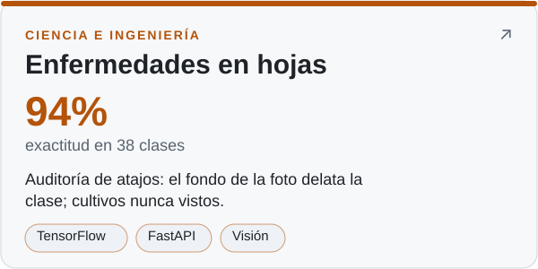</picture></a>
<a href="https://github.com/c4r0l13/dog-adoption-analysis"><picture><source media="(prefers-color-scheme: dark)" srcset="assets/card-dog-adoption-analysis-dark.svg">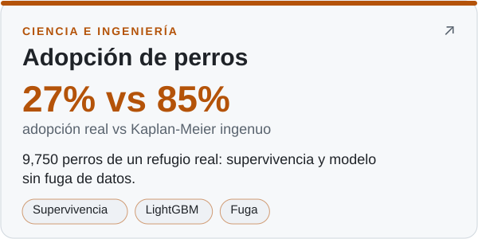</picture></a>

Calidad del aire, enfermedades en hojas y adopción de perros son versiones mejoradas de proyectos de mi cuenta anterior, <a href="https://github.com/caro1ie">caro1ie</a>.

## 🗺️ Mapa de proyectos

<picture>
  <source media="(prefers-color-scheme: dark)" srcset="assets/matrix-dark.svg">
  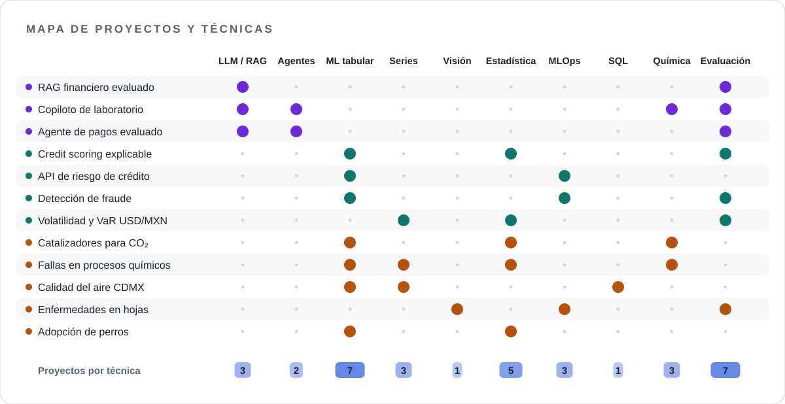
</picture>

## 🧭 Trayectoria

<picture>
  <source media="(prefers-color-scheme: dark)" srcset="assets/journey-dark.svg">
  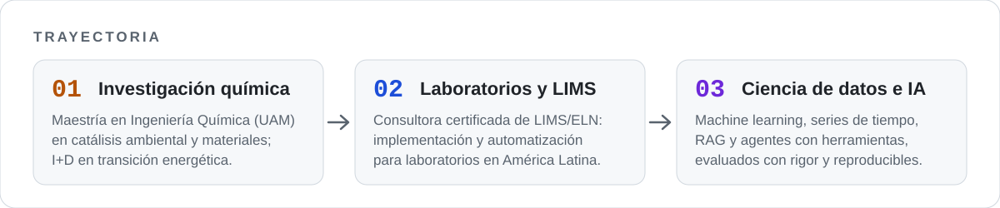
</picture>

## 🛠️ Herramientas

<picture>
  <source media="(prefers-color-scheme: dark)" srcset="assets/stack-dark.svg">
  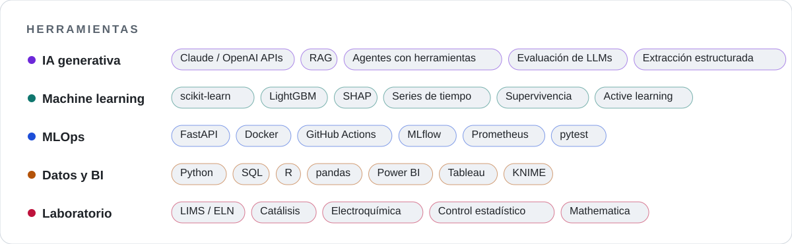
</picture>

## 📋 Diplomados

`Ciencia de Datos` · `Machine Learning` · `Inteligencia Artificial` · `Manejo de SQL` · `Bases de Datos` · `LIMS` · `ELN` · `Matemáticas` · `Bioinformática` · `Sostenibilidad` · `Gestión de Proyectos` · `Ciberseguridad` · `Marketing`

## 🐍 Contribuciones

<picture>
  <source media="(prefers-color-scheme: dark)" srcset="https://raw.githubusercontent.com/c4r0l13/c4r0l13/output/github-contribution-grid-snake-dark.svg">
  
</picture>

Las gráficas de esta página se generan con <code>scripts/build_assets.py</code>: SVG puro, sin servicios externos, con versión clara y oscura.

